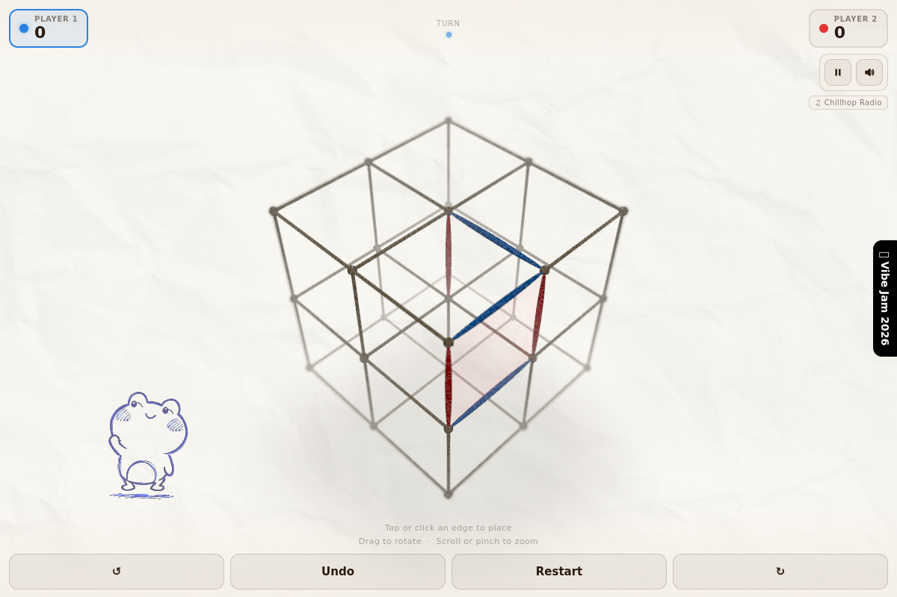
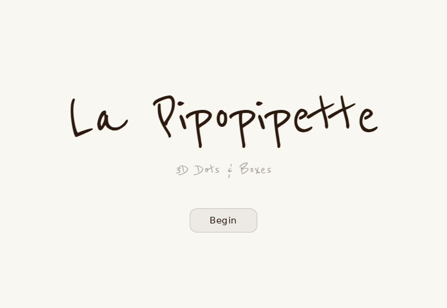
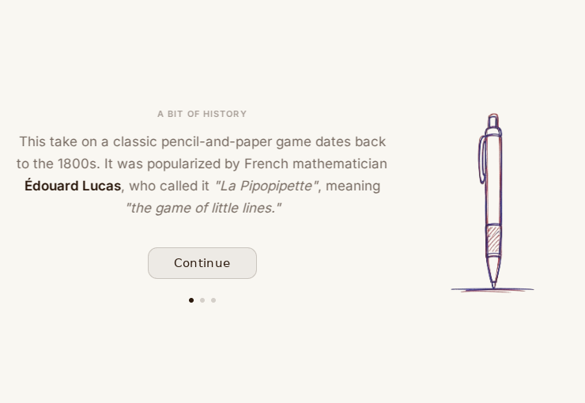
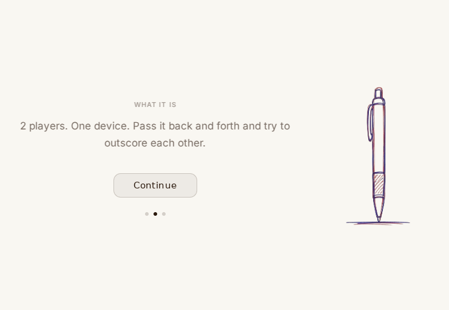
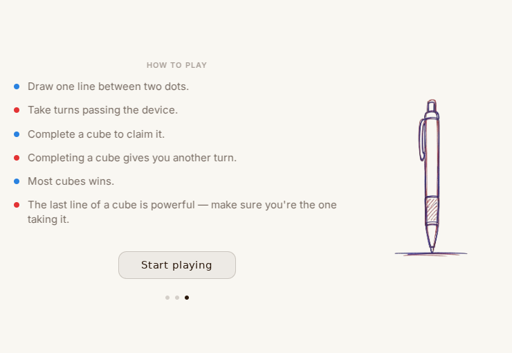
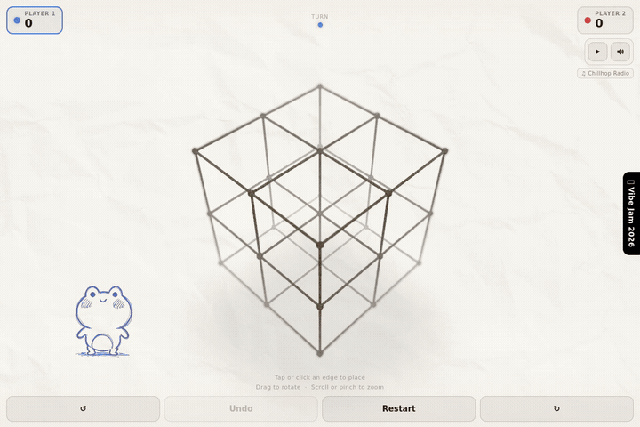

# La Pipopipette

**A pencil-and-paper game, reimagined in 3D for two people sharing one device.**

[Play the game](https://whatifqu3stion.github.io/la-pipopipette/) · [Install and run La Pipopipette](#install-and-run-la-pipopipette) · [Game code](artifacts/dots-and-boxes-3d/src/game)

<p align="center">
  
  <br><sub>The board stays central. Everything else needs to earn its space.</sub>
</p>

## From a bus ride to a hackathon

The idea came from a bus ride and the appeal of a simple game for passing the time. I built La Pipopipette for a hackathon, taking the familiar turn-taking of Dots & Boxes into a small 3D board.

I wanted to find out whether that extra dimension would make a shared game more interesting, or just make it harder to play. The current version is a playable exploration of that question. Real-user playtesting is still ahead.

My work focused on the concept, rules, visual direction, onboarding, and refining the experience. Implementation developed through AI-assisted work in Replit.

## Getting people into the game

First-time players see **title → history → two-player format → how to play**. Progress dots and a Skip button give them a way through; later visits go straight to the board using a versioned browser-storage flag.

<table>
  <tr>
    <td align="center"><br><sub>Keep the pencil-and-paper character.</sub></td>
    <td align="center"><br><sub>Give it a little context.</sub></td>
  </tr>
  <tr>
    <td align="center"><br><sub>Explain the shared-device setup.</sub></td>
    <td align="center"><br><sub>Make the first move and the goal clear.</sub></td>
  </tr>
</table>

Handwriting works for the title; instructions use Inter for readability. Keeping the pen illustration mounted between steps removed a distracting flicker. The history screen may add charm, but it is also something to test: new players may simply want to reach the board sooner.

## Making a move feel like drawing

<p align="center">
  
  <br><sub>Excerpts from a local production build. The GIF is silent.</sub>
</p>

The board has 27 dots, 54 edges, and eight cubes. Place one line per turn. Completing a face adds visual feedback; completing a whole cube earns a point and another turn. Most cubes wins.

**Thin lines, generous targets.** Invisible hit geometry surrounds each edge, so a player does not have to tap precisely on the visible stroke. That lets the drawing stay delicate without making the controls equally delicate.

**Looking around should not place a line.** Taps place edges; drags rotate or tilt the board after a movement threshold. Pinch and scroll zoom, and rotation buttons offer quarter turns. The camera can rest between those positions to expose awkward edges.

**Feedback needs an order.** A line finishes drawing before the face fills. Player colors connect the board, score, and turn indicator. The frog and rabbit add personality on wider screens, but disappear on narrower layouts to leave room for the game.

**A mistaken tap should be recoverable.** One-step undo restores the board, score, and active player without asking for confirmation on every move.

The paper texture, sketch-like strokes, drawing sounds, and optional music carry the original game's tactile feel into the interface. Whether those choices are satisfying is a question for players, not something the visual polish proves.

## What changed during development

These are implementation lessons, not findings from a user study.

| What got in the way | What changed |
| --- | --- |
| An early gravity restriction added another rule to explain. | The shipped game accepts any unplaced edge. The effect on strategy still needs testing. |
| Characters and decorative text competed with the game. | Instructions gained a readable typeface; character scale, placement, and responsive behavior were revised. |
| Some mobile configurations showed a blank board. | A simpler render target skips multisampling and the depth-texture grain pass on likely mobile devices. Rendering the board matters more than preserving every effect. |
| The board did not reliably fit a changing viewport. | Resize observation moved to the canvas parent, with camera fitting and zoom limits based on its dimensions. |

Examples in the history: [onboarding readability](https://github.com/whatifqu3stion/la-pipopipette/commit/35f8b899b1dc533c18c0cb42e2537a11d38de86e) · [mobile rendering](https://github.com/whatifqu3stion/la-pipopipette/commit/5b994b21026b8e5d9ebc5a3f5495d31a60b70675) · [viewport resizing](https://github.com/whatifqu3stion/la-pipopipette/commit/6e7fb5784006581006ca9c1700253dfd1de52889).

## How the game is put together

**React · TypeScript · Three.js · Vite · pnpm · GitHub Actions / Pages**

The game runs in the browser without an account, API server, or database. The wider workspace contains backend scaffolding, but the game does not depend on it.

| Layer | Responsibility and source |
| --- | --- |
| Rules and state | Grid, legal moves, cube ownership, scores, turns, and undo snapshots: [GameModel](artifacts/dots-and-boxes-3d/src/game/GameModel.ts), [GameState](artifacts/dots-and-boxes-3d/src/game/GameState.ts). |
| Input and camera | Edge selection, mouse/touch gestures, rotation, zoom, and viewport fit: [InputController](artifacts/dots-and-boxes-3d/src/game/InputController.ts), [CameraController](artifacts/dots-and-boxes-3d/src/game/CameraController.ts). |
| Rendering | Ink geometry, fills, lighting, effects, and animation: [Renderer](artifacts/dots-and-boxes-3d/src/game/Renderer.ts). |
| Coordination and UI | Connect rule events to visuals and audio; show onboarding, scores, characters, and the end state: [Game](artifacts/dots-and-boxes-3d/src/game/Game.ts), [App](artifacts/dots-and-boxes-3d/src/App.tsx). |

Rules are separate from rendering, so changing the look does not redefine scoring. The model uses coordinates and adjacency as its source of truth; events connect those rules to animation and sound. Undo restores a state snapshot rather than trying to visually reverse a move.

Deployment builds only the game package. Pull requests run its TypeScript check and production build; pushes to `la-pipopipette` publish to GitHub Pages. The existing captures also exercise onboarding, placement, rotation, and undo in desktop Chromium. These checks do not replace playtesting.

## Install and run La Pipopipette

Use Git, Node.js 24.22.1 or a later 24.x release, and pnpm 11.28.0, matching the [deployment workflow](.github/workflows/pages.yml). Other supported Node ranges are listed in [package.json](package.json). The commands below use a POSIX shell, such as Terminal on macOS/Linux or Git Bash on Windows.

1. **Clone the game branch and open its folder.**

   ```sh
   git clone --branch la-pipopipette https://github.com/whatifqu3stion/la-pipopipette.git
   cd la-pipopipette
   ```

2. **Install the game and its workspace dependencies.**

   ```sh
   pnpm install --frozen-lockfile --filter @workspace/dots-and-boxes-3d...
   ```

3. **Start the development server.**

   ```sh
   PORT=5173 BASE_PATH=/ pnpm --filter @workspace/dots-and-boxes-3d run dev
   ```

4. **Open `http://localhost:5173/`.** Use a browser with WebGL support. Fonts and music use external services, and sound playback depends on browser media policies.

For a code check, run `pnpm --filter @workspace/dots-and-boxes-3d run typecheck`. The [Pages guide](docs/github-pages.md) covers production builds and deployment.

## What I'd test next

I'd start with pairs playing both the original 2D game and this version, alternating which they try first. Can they explain what earns a point? Select the edge they intended? Recover from a mistake? Do they choose another round, and why?

That would help separate confusion with the rules from difficulty controlling the board. Phone-sized play, keyboard gameplay, reduced motion, and cues beyond player color also need further work.

The [original product brief](attached_assets/3d_dots_boxes_prd-1_1776650032671.md) is kept as an early design artifact. Its gravity rule and some visual requirements were superseded during development.
